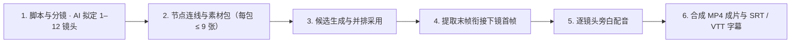
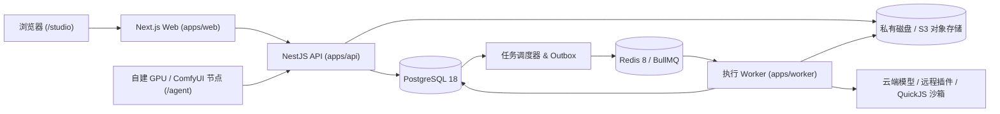

<div align="center">

<p align="center">
  
</p>

<h1 align="center">弗淼 · Fumiao｜多模型 AI 视频、图片、语音与画布创作工作台</h1>

<a href="https://github.com/ninjaz0/fumiao">
  <picture>
    <source media="(prefers-color-scheme: dark)" srcset="https://readme-typing-svg.demolab.com?font=Fira+Code&size=32&duration=3000&pause=1000&color=FFFFFF&center=true&vCenter=true&width=680&lines=Fumiao+AIGC;%E5%A4%9A%E6%A8%A1%E5%9E%8B+AI+%E5%88%9B%E4%BD%9C%E5%B7%A5%E4%BD%9C%E5%8F%B0;%E4%BB%8E%E4%B8%80%E4%B8%AA%E6%83%B3%E6%B3%95%EF%BC%8C%E5%88%B0%E4%B8%80%E6%94%AF%E5%AE%8C%E6%95%B4%E6%88%90%E7%89%87" />
    
  </picture>
</a>

<p align="center">
  <a href="https://github.com/ninjaz0/fumiao/actions/workflows/ci.yml">
    
  </a>
  <a href="https://github.com/ninjaz0/fumiao/stargazers">
    
  </a>
  <a href="https://github.com/ninjaz0/fumiao/network/members">
    
  </a>
  <a href="https://github.com/ninjaz0/fumiao/issues">
    
  </a>
  <a href="https://github.com/ninjaz0/fumiao/commits/main">
    
  </a>
</p>

<p align="center">
  
  
  
  
  
  
  
</p>

弗淼（Fumiao）是面向个人与团队的自部署多模型 AI 创作工作台：在 `/studio` 完成对话构思、节点画布与分镜编排、视频 / 图片 / 语音生成及成片合成，并通过版本化插件自由接入云端模型服务与自建 GPU / ComfyUI 节点。<br />
<sub>Self-hosted multi-model AI creative studio for individuals &amp; teams · node canvas &amp; storyboard · multi-tenant workspaces · versioned plugin &amp; GPU node-pool platform</sub>

<p align="center">
  <a href="#highlights">核心亮点</a> ·
  <a href="#capabilities">创作与协作</a> ·
  <a href="#plugins">插件生态</a> ·
  <a href="#deploy">快速部署</a> ·
  <a href="#development">本地开发</a> ·
  <a href="#architecture">系统架构</a> ·
  <a href="#docs">文档索引</a>
</p>

</div>

---

## 1. ✨ 核心亮点

<a id="highlights"></a>

| 能力 | 说明 |
| --- | --- |
| 🎬 **多模态统一工作台** | 在 `/studio` 一站式完成视频生成、图片生成、语音旁白与流式 AI 对话，提示词、参考素材与作品库全链路贯通。 |
| 🧩 **节点画布与分镜成片** | 基于可视化节点画布连线传递提示词与有序参考图；支持 AI 拟定 1–12 镜头分镜、双候选对比采用、末帧衔接、分镜旁白与 MP4 / SRT / VTT 导出。 |
| 👥 **个人与团队多空间隔离** | 每个账号拥有独立个人空间，管理员可创建团队空间并分配成员；资产、画布、任务与对话严格按空间隔离，团队共用积分池。 |
| 🔌 **版本化插件与沙箱扩展** | 单文件 `.fmplugin.json` 导入与签名校验升级；支持模型接入、QuickJS 沙箱扩展页、工作区事件订阅、资源菜单、自定义导出器与支付渠道。 |
| ⚡ **分布式 GPU / ComfyUI 节点池** | Pull 模式节点执行协议，支持自建算力机配对、180s 租约续期、成片 FFprobe / 完整解码验收，内置 MiniMax H3、Breeze TTS 2 与 ComfyUI 示例。 |
| 💰 **账本级积分与幂等结算** | 提交即冻结积分、插件版本与配置快照；重试、进程重启与并发回调均只结算一次，失败或取消自动退回；支持支付宝与 USDT 充值扩展。 |
| 🛡️ **私有媒体与企业级安全** | 凭据采用 AES-256-GCM 加密存储；支持私有磁盘与 S3 分段（Range）流式传输及原子计量存储配额（默认 20 GiB），可多副本水平扩容。 |
| 🐳 **Docker Compose 开箱即用** | 完整编排 PostgreSQL 18、Redis 8 / BullMQ、NestJS API、Worker 与 Next.js 前端，支持全量备份演练与旧版 Pure 工作区平滑迁移。 |

**创作流程**：AI 对话构思 → 分镜编排（手动 / AI 拟定） → 整理素材包（人物 / 场景 / 风格） → 镜头候选生成与并排采用 → 分镜旁白配音 → 合成 MP4 成片与字幕下载。

### 常见问题

**弗淼（Fumiao）适合谁？** 适合需要统一管理多模型生成、分镜画布制作、团队素材共享、精细权限与积分结算的创作团队及自部署开发者。

**支持接入哪些模型和算力？** 官方提供 Flow2API、Muse2API、OpenAI 兼容流式对话（DeepSeek / OpenAI / 自建兼容接口）及自建 GPU 节点（MiniMax H3、Breeze TTS 2）等插件包，同时支持按开放契约接入第三方远程 HTTP 模型服务与 ComfyUI 节点池。

**团队协作时数据会串空间吗？** 不会。个人空间与团队空间的素材、任务、画布、草稿与对话按工作区严格隔离，私有媒体每次访问均做工作区鉴权，画布自动保存携带乐观并发版本校验，冲突时保留用户草稿且不静默覆盖。

**如何部署？** 推荐使用仓库自带的 Docker Compose 一键编排全部服务，详见 [第 4 节 快速部署](#deploy)。

---

## 2. 🎬 创作与协作能力

<a id="capabilities"></a>

### 2.1 多模态创作、资产库与任务队列

| 模块 | 核心特性 |
| --- | --- |
| **视频生成** | 文生视频与多参考生视频；支持图片、视频、音频原生参考、首尾帧槽位、画幅比例、清晰度、时长与随机种子控制（如 MiniMax H3、Muse、Flow）。 |
| **图片生成** | 文生图与参考图再创作；内置独立线程原生图片解码与转换，自动兼容 PNG / JPEG / WebP / GIF / AVIF / HEIF 并校正拍摄 EXIF 方向。 |
| **语音生成** | 输入台词并用自然语言描述音色与朗读风格（如 Breeze TTS 2），生成标准 PCM WAV 旁白并直接沉淀到资产库。 |
| **AI 对话** | 流式对话构思脚本、打磨文案与整理提示词，支持将对话结果一键送入画布继续制作。 |
| **资产库与素材包** | 统一管理历史作品、收藏、分类与批量原文件下载；正在被画布或任务引用的素材受保护不会被误删；可将人物、服装、场景整理为最多 9 张有序图片的素材包。 |
| **透明任务队列** | 分阶段展示排队、准备、生成与回传状态及耗时预估；超时如实呈现处理状态，排队任务可安全取消并即时释放冻结积分。 |

### 2.2 节点画布与分镜成片工作流

弗淼将自由连线的节点画布与结构化分镜流程整合在同一个项目中，每一步产出直接成为下一步输入：



- **版本保护与协作**：多人编辑同一画布时自动保存并校验版本号；遇到并发修改会明确提示并完整保留本地草稿。
- **不可变执行快照**：提交镜头生成或导出时冻结所用素材包版本、参数、模型插件版本与单价，后续编辑素材包或调整全站定价均不会污染在途任务。

### 2.3 多租户空间、权限与账本结算

- **两级访问控制**：支持邀请码注册；每个模型的可见性与可用性同时受全站开关与团队空间权限控制，管理员可按清晰度 / 时长 / 档位细粒度配置积分价格（0 表示免费）。
- **单次结算与容错**：任务提交前实时展示所需积分并原子冻结；平台针对重试、服务重启、并发回调、租约过期提供严格幂等保护；上游结果未知的任务标记为 `uncertain` 并保留冻结积分，禁止盲目重发，可由管理员经 `pnpm jobs:reconcile` 核对并记录理由后结算。

---

## 3. 🧩 插件与扩展生态

<a id="plugins"></a>

弗淼采用**平台核心 + 版本化插件包**设计：核心负责认证、租户隔离、媒体权限、积分账本与状态持久化，所有模型接入、自建算力节点、画布导出器、支付网关与工作区自动化均以独立的 `.fmplugin.json` 单文件包交付。

管理员在「设置 → 插件」导入插件后，确认页会逐项展示版本、模型清单、设置字段与所需宿主权限；导入后默认关闭，测试连接并配置定价后即可对全平台开放，并支持经 HTTP(S) 或 Git 源按 SHA-256 摘要检查更新与版本回滚。

### 官方插件包

| 插件包 | 文件 | 类型 | 能力说明 |
| --- | --- | --- | --- |
| **Flow2API** | [`flow.fmplugin.json`](plugins/flow/flow.fmplugin.json) | 沙箱模型提供方 | 接入公网 HTTPS Flow2API 服务（v2.0），在 QuickJS 沙箱中完成流式解析、参考图输入与宿主机产物校验，支持 Veo / Omni 等模型。 |
| **Muse2API** | [`muse.fmplugin.json`](plugins/muse/muse.fmplugin.json) | 沙箱模型提供方 | 接入公网 HTTPS Muse2API 服务（v2.0），在沙箱中支持异步图片 / 视频生成、上游任务续查与产物恢复落盘。 |
| **GPU 节点** | [`gpu.fmplugin.json`](plugins/gpu/gpu.fmplugin.json) | Pull 节点池 | 自建 GPU 工作机配对与任务调度（v2.0），支持 MiniMax H3 原生多模态参考与 Breeze TTS 2 语音。 |
| **兼容对话** | [`compatible-chat.fmplugin.json`](plugins/compatible-chat/compatible-chat.fmplugin.json) | 沙箱模型提供方 | OpenAI 协议兼容流式对话（v2.0），沙箱解析与宿主密钥注入，内置 DeepSeek、OpenAI 预设并支持自建公网 HTTPS 兼容服务。 |
| **分镜合成** | [`storyboard.fmplugin.json`](plugins/storyboard/storyboard.fmplugin.json) | 画布导出扩展 | 在 Worker 中执行受限 MP4 合成计划，支持镜头编排、旁白音轨替换与字幕输出。 |
| **充值渠道** | [`payments.fmplugin.json`](plugins/payments/payments.fmplugin.json) | 支付扩展 | 版本化充值网关扩展，内置支付宝与 USDT-Plasma 签名校验、查单确认与事务内单次入账。 |

<details>
<summary><strong>展开查看插件扩展点与开发示例包</strong></summary>

弗淼的插件平台（`contributes` v1）在受限 **QuickJS 沙箱**与声明式宿主能力边界下运行，禁止向浏览器注入任意插件脚本，全部操作记录至审计日志（`studio_plugin_audit`）：

- **声明式设置页 (`settingsPages`) & 持久化设置 (`settings`)**：一个插件最多贡献 8 个设置页（支持管理员 / 成员受众与乐观并发修订号），宿主统一渲染视图块（统计、列表、内联 / 弹窗表单）并在版本升级时执行 `migrate`。
- **宿主受控能力 (`hostCapabilities`)**：按需申请 `media`（探测 / 转码 / 拼接 / 抽帧）、`data`（插件私有键值存储）、`http`（白名单 HTTPS 出站请求，阻断内网与重定向）与 `nodes`（节点池管理）。
- **工作区事件 (`events`) & 资源菜单 (`actions`)**：订阅 `job.completed`、`job.failed`、`asset.created`、`member.added` / `removed`，或在素材 / 任务详情菜单追加自定义操作，失败自动退避重试并记录死信。
- **远程 HTTP 提供方 & Pull 节点池**：支持任意语言实现 `/health`、`/submit`、`/inspect` 远程模型服务，或通过节点池协议接入 ComfyUI 等自有算力集群。

仓库内置以下参考示例包，可直接导入体验或运行 `pnpm plugins:pack` 重新打包：

| 示例包 | 文件 | 演示内容 |
| --- | --- | --- |
| **ComfyUI 节点池** | [`example-node-pool.fmplugin.json`](plugins/example-node-pool/example-node-pool.fmplugin.json) | Pull 模式节点池 v1 接入 Linux ComfyUI 机器，附带工作区媒体处理演示页 |
| **模型目录示例** | [`example-extension.fmplugin.json`](plugins/example-extension/example-extension.fmplugin.json) | 全站 / 工作区双层设置、版本迁移回滚与 `host.data` 键值存储 |
| **素材自动分类** | [`example-asset-tags.fmplugin.json`](plugins/example-asset-tags/example-asset-tags.fmplugin.json) | 订阅 `asset.created` 事件按 MIME 自动归类，并提供详情菜单查看 |
| **审片备注** | [`example-review-notes.fmplugin.json`](plugins/example-review-notes/example-review-notes.fmplugin.json) | 在任务详情「更多」菜单保存和读取当前工作区的审片备注 |

详细规范请阅读 [插件开发指南](docs/PLUGINS.md)、[插件扩展平台设计](docs/PLUGIN_EXTENSIBILITY.md) 与 [GPU 节点与生成参数](docs/NATIVE_GPU.md)。

</details>

---

## 4. 🚀 快速部署

<a id="deploy"></a>

<a id="docker-compose-启动"></a>

### 4.1 Docker Compose 启动

部署需要 Git、Docker Engine 与 Docker Compose v2+。仓库提供生产多阶段 [`Dockerfile`](Dockerfile) 与 [`compose.yaml`](compose.yaml)，自动编排 PostgreSQL 18、Redis 8、迁移任务、NestJS API、BullMQ Worker 与 Next.js 前端。

#### 第 1 步：准备环境配置

```sh
git clone https://github.com/ninjaz0/fumiao.git
cd fumiao
cp .env.example .env
chmod 600 .env
```

编辑 `.env`，务必填写以下必填项：

- `POSTGRES_PASSWORD`：随机字母数字数据库密码
- `PUBLIC_URL`：浏览器访问站点的完整 origin（本机体验填 `http://localhost:3000`，公网 HTTPS 填 `https://your-domain.example`）
- `ENCRYPTION_KEY`：固定的 32 字节 Base64 密钥，可用 `openssl rand -base64 32` 生成，**须随数据库备份妥善保管**

#### 第 2 步：构建镜像并执行迁移

```sh
docker compose build
docker compose up migrate
```

#### 第 3 步：初始化管理员并启动服务

全新安装时，先将自选的 `ADMIN_PASSWORD` 导出为环境变量再初始化管理员（已有 Pure 工作区请先在独立目标上完成 [数据导入](docs/MIGRATION.md)）：

```sh
export ADMIN_PASSWORD='请替换为强密码'
docker compose run --rm --no-deps -e ADMIN_PASSWORD api pnpm bootstrap
docker compose up -d --wait
```

#### 第 4 步：登录工作台并配置插件

打开 `http://localhost:3000/studio`，使用默认管理员用户名 `admin` 与刚设置的密码登录：

1. 进入 **「设置 → 插件」** 点击 **「导入插件」**。全新安装的列表为空，可按需导入仓库提供的 [Flow2API](plugins/flow/flow.fmplugin.json)、[Muse2API](plugins/muse/muse.fmplugin.json)、[GPU 节点](plugins/gpu/gpu.fmplugin.json)、[兼容对话](plugins/compatible-chat/compatible-chat.fmplugin.json)、[分镜合成](plugins/storyboard/storyboard.fmplugin.json) 与 [充值渠道](plugins/payments/payments.fmplugin.json)。
2. 确认插件版本、模型清单与权限后，在卡片中打开 **「设置」**，填写服务地址及密钥并测试连接；勾选要开放的模型，进入 **「生成定价」** 设置各档积分，或为同一插件添加多个服务连接。卡片开关对全平台生效。
3. 安装 GPU 插件后，平台管理员可在 **「设置 → GPU 节点」** 生成配对命令并接入算力服务器；关闭插件后仍可管理节点并继续处理已受理任务。
4. 在创作页选择模型即可开始生成。管理员可随时在插件卡片检查更新、查看变更说明并确认安装，详见 [插件包及更新源格式](docs/PLUGINS.md)。

<details>
<summary><strong>常用 Docker 运维命令与数据卷说明</strong></summary>

Compose 默认创建 `postgres`、`redis` 与 `media` 三个命名数据卷。停止或重建容器会保留数据，**请勿在生产环境执行 `docker compose down -v`，该命令会永久删除数据卷**。

```sh
docker compose ps                 # 查看所有服务健康状态
docker compose logs -f api worker # 查看 API 与 Worker 实时日志
docker compose restart api worker # 重启后端服务
docker compose down               # 停止并移除容器（保留数据卷）
```

生产停写备份应完整涵盖 PostgreSQL（`pg_dump --format=custom`）、私有媒体存储、`ENCRYPTION_KEY` 与部署配置，严禁仅备份 Redis。完整备份、还原与演练步骤见 [运维手册](docs/OPERATIONS.md)。

</details>

---

### 4.2 反向代理、对象存储与生产说明

- **HTTPS 反向代理**：Compose 默认将 Web 绑定在 `127.0.0.1:3000`。对外提供服务时通过 HTTPS 反向代理转发至 Next.js，保留 `Host` 与 `Origin`，设置 `X-Forwarded-Proto: https`，并确保 SSE 流式响应逐段透传。`PUBLIC_URL` 必须与浏览器访问的 origin 完全一致；若同一实例存在多个受信任入口，可在 API 配置 `STUDIO_ADDITIONAL_ORIGINS`。
- **媒体存储与多副本扩容**：单机默认使用共享 `media` 卷（`MEDIA_DIRECTORY`）；水平扩容多副本 API / Worker / Web 前，请切换为私有 S3 对象存储（配置 `S3_BUCKET`、`S3_ENDPOINT`、`S3_REGION`、`S3_PATH_STYLE`、`STUDIO_MEDIA_ORIGIN` 及凭据），统一所有实例的 `ENCRYPTION_KEY` 并规划 PostgreSQL 连接总量（单进程连接池上限 15）。
- **凭据、沙箱边界与在途任务保护**：服务商密钥以 AES-256-GCM 加密写入数据库且不向前端明文回传，由宿主在出站请求时注入；Flow、Muse 与兼容对话的沙箱连接须配置获准的公网 HTTPS 服务；旧任务保留加密配置快照，更换密钥不影响在途任务。
- **旧实例迁移**：从 Pure 工作区迁移请遵循 [迁移指南](docs/MIGRATION.md)；涉及历史贡献设备或收益账本核对见 [贡献数据退役和对账](docs/FMWORKER_RETIREMENT_UPGRADE.md)。

---

## 5. 🛠️ 本地开发与验证

<a id="development"></a>

### 5.1 环境要求

| 组件 | 版本 / 说明 |
| --- | --- |
| **Node.js & pnpm** | Node.js `24`、pnpm `10.32.1`（通过 `corepack enable` 启用） |
| **数据与队列** | PostgreSQL `18`、Redis `8`（开启持久化并使用 `noeviction` 策略） |
| **多媒体与原生编译** | `ffmpeg` / `ffprobe`；构建 `packages/image-import` 原生图片解码器需 `CMake 3.20+`、`Ninja` 与 `C++` 编译器 |
| **辅助工具** | Python `3`（用于隔离 worktree 环境脚本、GPU 节点桥接与数据导出工具） |

### 5.2 隔离 Docker 快反环境（推荐）

每个开发任务可在独立 Git worktree 中运行 `scripts/worktree.py`，自动创建专属端口、`*.localhost` 会话隔离域名、测试管理员账号及独立 PG / Redis / 媒体卷：

```sh
python3 scripts/worktree.py up           # 构建开发镜像、执行迁移并打印本任务 /studio 地址与密码位置
python3 scripts/worktree.py status       # 查看本任务容器状态
python3 scripts/worktree.py logs api     # 查看指定服务日志（api / worker / web）
python3 scripts/worktree.py down         # 任务交付前清理容器和网络（保留数据卷）
```

> 开发者须在交付前运行 `python3 scripts/worktree.py down` 并用 `status` 确认容器列表为空。修复并自测通过后，将任务分支提交部署到本机 3000 端口的固定验收实例 `fumiao-acceptance`，负责人验收通过后再提 PR。完整研发协作规范见 [开发指南](AGENTS.md#从问题到合并)。

<details>
<summary><strong>展开本机直接启动（非 Docker）步骤</strong></summary>

先按 [本地工作台配置](docs/STUDIO.md) 准备专用 PostgreSQL、Redis、私有存储目录及环境文件，再执行：

```sh
corepack enable
pnpm install --frozen-lockfile
pnpm images:prepare
pnpm dev:web
```

需要以生产构建预览时，先停止开发预览再运行 `pnpm build` 与 `pnpm start:studio`。

</details>

### 5.3 测试与 CI 验证

| 验证维度 | 执行命令 | 说明 |
| --- | --- | --- |
| **代码规范与包边界** | `pnpm lint` | 拒绝越包相对路径、未声明依赖及未处理的 Promise |
| **类型检查** | `pnpm typecheck` / `pnpm typecheck:web` | 分别检查后端共享库与 Next.js 前端类型 |
| **平台与插件单测** | `pnpm test` | 传入专属 `TEST_DATABASE_URL` 和 `TEST_REDIS_URL` 可运行真实 PG / Redis / BullMQ 并发用例 |
| **生产构建与端到端验收** | `pnpm build && pnpm exec playwright install chromium && pnpm test:studio` | 从正式入口验证登录、生成、支付回跳、画布、私有媒体、结算、重启与路由；需 `initdb`、`postgres`、`redis-server`（支持 `PG_BINDIR`、`REDIS_SERVER`） |
| **专项高可靠套件** | `pnpm test:studio:remote-provider` / `restore` / `replicas` / `https` | 分别覆盖远程插件、停写备份还原、多实例并发与 HTTPS 反向代理入口 |

向 `main` 提 PR 或推送代码时，GitHub Actions 的 [`verify`](.github/workflows/ci.yml) 工作流会在 PostgreSQL 18 + Redis 8 环境中自动执行 lint、原生解码器编译、平台测试、生产构建、Chromium 正式入口验收、远程插件验收与 Docker 镜像构建。

---

## 6. 🏗️ 系统架构与项目结构

<a id="architecture"></a>

### 进程拓扑



### Monorepo 目录结构

`apps/*`、`packages/*`、`plugins/*` 均为 pnpm workspace 包，跨包统一按 `@fumiao/<包名>` 引用，[分层依赖方向](AGENTS.md#包和依赖方向)由 ESLint 强制校验：

| 目录 | 用途 |
| --- | --- |
| `apps/web` | Next.js 16 / React 19 前端（首页、登录、`/studio` 工作台、React Flow 节点画布、设置控制台及 `/api` `/agent` `/media` 代理） |
| `apps/api` | NestJS 11 HTTP 服务（Studio 协议、工作区鉴权、私有媒体流式输出、节点网关、插件页面与操作代理） |
| `apps/worker` | BullMQ 后台执行进程（异步生成、任务续查、分镜合成、工作区事件投递与对账） |
| `packages/plugin-sdk` | 插件 manifest、Studio 模型表单、扩展贡献（`contributes`）与节点池契约定义 |
| `packages/platform` | 核心领域层（账本、租约、队列调度、对象存储、QuickJS 沙箱、插件生命周期与加密安全） |
| `packages/original-api` | Studio 业务协议层（账号、工作区、资产库、素材包、画布、对话、充值与分镜导出） |
| `packages/image-import` | 独立线程图片解码与格式规范化（内置 CMake/C++ 原生 HEIF 解码与 AVIF WASM） |
| `packages/web-compat`、`media-runtime` | 前端兼容路由、静态资源清单与媒体运行时辅助 |
| `plugins/` | 官方模型适配器、GPU 节点池、分镜导出、充值渠道及可导入扩展包源码 |
| `migrations/`、`scripts/` | PostgreSQL SQL 迁移、管理员初始化、旧数据导入、任务对账、插件打包与 worktree 环境脚本 |
| `baseline/` | 随工作台发布的静态资源、文件指纹与 HTTP 路由契约清单 |
| `tests/` | 平台并发测试、插件契约测试与 Playwright 正式入口集成测试 |

<a id="docs"></a>

### 文档索引

| 文档 | 内容 |
| --- | --- |
| [开发指南 (`AGENTS.md`)](AGENTS.md) | 代码入口地图、包依赖分层规范、隔离快反环境与研发验收流程 |
| [本地工作台 (`docs/STUDIO.md`)](docs/STUDIO.md) | 非 Docker 持久化本地环境配置、HTTPS 反向代理与插件设置页 |
| [运维与验收 (`docs/OPERATIONS.md`)](docs/OPERATIONS.md) | 进程拓扑、凭据与媒体安全、停写备份恢复演练、故障语义与多实例验证 |
| [插件开发 (`docs/PLUGINS.md`)](docs/PLUGINS.md) | `.fmplugin.json` 打包发布、更新源、宿主能力、节点池 v1 与远程 HTTP 协议 |
| [插件扩展平台 (`docs/PLUGIN_EXTENSIBILITY.md`)](docs/PLUGIN_EXTENSIBILITY.md) | `contributes` v1 架构、设置生命周期、工作区事件、导出器与支付扩展设计 |
| [GPU 节点与参数 (`docs/NATIVE_GPU.md`)](docs/NATIVE_GPU.md) | 输入冻结、成片 FFprobe / 解码校验规则与节点能力声明 |
| [数据迁移 (`docs/MIGRATION.md`)](docs/MIGRATION.md) | 从旧版 Pure 备份导出、校验指纹并导入新实例的完整流程 |

---

## 7. 🤝 参与贡献

欢迎通过 [GitHub Issues](https://github.com/ninjaz0/fumiao/issues) 反馈问题、提出功能建议或分享插件扩展。

提交代码前请先阅读 [开发指南](AGENTS.md)：

1. 从最新 `main` 创建独立 worktree 与特性 / 修复分支（`feat/*` 或 `fix/*`）。
2. 在隔离环境完成复现、实现与自测，并执行 `pnpm lint`、`pnpm typecheck`、`pnpm typecheck:web` 及受影响范围的测试。
3. 提交 PR 时附带清晰的改动说明、验证记录及必要的路由 / 视口截图，等待 CI `verify` 全部通过。

---

<div align="center">

<sub>弗淼 · Fumiao — 从一个想法，到一支完整成片</sub>

</div>


