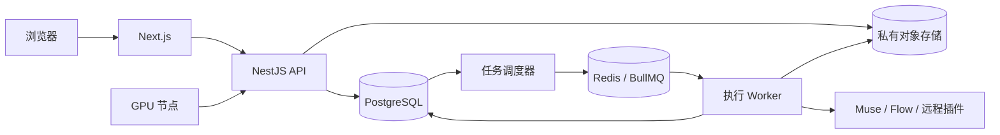

# 运行与验收

## 进程拓扑

API、worker、Web 可分别扩容。数据库保存可恢复任务状态；Redis 队列只负责分发。启用多副本前改用共享 S3，统一所有实例的 `ENCRYPTION_KEY`，并控制数据库连接总量（当前每进程连接池上限 15）。不要让单个插件的并发超过其上游许可。

## 启动顺序

Compose 启动 Studio 协议的 NestJS。先运行 `docker compose build` 和 `docker compose up migrate`，然后初始化管理员或导入旧实例。API 启动检查 PostgreSQL、活跃管理员、配置中的导入标识、私有磁盘路径及 BullMQ Redis；Web 和 worker 在 API 健康后启动。Web 在运行时读 `API_INTERNAL_URL`，镜像无需包含环境配置。详见 [Docker 初始化](../README.md#docker-compose-启动) 和 [导入步骤](MIGRATION.md#导出与导入)。

`WORKER_CONCURRENCY` 控制单个 worker 处理数，默认 8。连接的并发是所有 worker 合计的数据库约束。GPU 连接的并发同样跨节点生效。

## 升级 Flow、Muse 和兼容对话

1. 记录当前宿主和已安装插件版本，按下文的停写流程备份数据库、私有媒体和加密密钥。
2. 更新宿主并完成迁移。管理员在「设置 → 插件」导入相应的 2.0.0 包，核对服务地址、密钥注入和媒体域名权限后确认更新。
3. 检查每个服务。保留公网 HTTPS 地址的服务沿用原设置。显示暂停提示的服务保留原地址和启用状态，更换为可解析的公网 HTTPS 地址后保存。更换服务源时重新输入对应密钥。
4. 核对升级前受理任务的状态、作品和账本。Worker 按接单时的版本、加密配置和价格继续处理。需要恢复原生版时，在停止写入后恢复升级前的宿主和同一时间点的备份。先核对备份点之后已发生的扣费及上游回执，再恢复派发。

## 凭据与媒体

密钥使用 AES-256-GCM 加密写入 PostgreSQL，连接 API 不返回明文。旧任务保留加密配置快照，用于避免管理员换密钥时改变在途任务。加密密钥和数据库应独立备份并一同恢复。生产数据库和 Redis 只允许内部网络访问，站点由 HTTPS 入口提供服务。Flow、Muse 和兼容对话的沙箱连接需要配置获准的公网 HTTPS 服务。

Studio 内嵌的图片、音频和视频支持浏览器私有缓存。普通刷新会重新鉴权，素材未变时返回 304。磁盘和 S3 均支持分段读取。S3 的浏览器内嵌请求（`Sec-Fetch-Dest` 为 `image`、`audio` 或 `video`）由 API 流式传输，直接下载继续使用短期签名地址。上传会实际解析内容。工作区默认 20 GiB 配额，数据库触发器原子计量，避免并发上传超额。修改配额可通过受控数据库迁移操作 `workspaces.storage_limit`；当前没有管理页配额编辑。

备份包含 PostgreSQL、对象存储、加密密钥和部署配置。定期演练还原，禁止仅备份 Redis。上传后数据库提交失败可能产生未引用媒体对象，清理应以数据库引用核对并保留宽限期；当前未附带自动对象垃圾回收器。

## 目标栈停写备份与恢复

1. 关闭写入入口，停止 API、调度器和 worker，并停止 GPU 节点回传。记录 PostgreSQL 中待处理任务的状态、上游任务 ID、回执及租约。计划停机时可先排空任务再停进程。
2. 使用匹配服务器版本的 `pg_dump --format=custom --file=studio.dump --dbname="service=studio-source"`。保持停写，按原对象键导出私有桶的对象内容、MIME 类型及元数据，核对清单、大小和 SHA-256。单独保管 `ENCRYPTION_KEY` 与部署配置，并将它们关联到同一份备份。
3. 启动独立 PostgreSQL 实例、新 Redis 和新私有桶。使用 `pg_restore --single-transaction --exit-on-error --no-owner --no-privileges --dbname="service=studio-target" studio.dump` 写入空数据库，按目标部署角色配置数据库权限。按对象清单还原至新桶并复核字节。上述 `service` 名须在 PostgreSQL 客户端连接配置中分别指向源和目标。
4. 使用目标 PostgreSQL、Redis 和对象存储连接配置，保留备份对应的 `ENCRYPTION_KEY`。将 `STUDIO_MEDIA_ORIGIN` 指向可供浏览器访问的目标 S3 签名地址源。先对账钱包余额、冻结额、最后一笔账本及充值记录，再启动同版本 Next、Nest 和 worker。验收原会话和重新登录、公开编号、私有媒体、画布和对话，复核待处理任务和重复提交后再恢复写入。

合成演练入口为 `pnpm build` 后运行 `pnpm test:studio:restore`。需要 Node 24、pnpm、PostgreSQL 的 `initdb`、`postgres`、`pg_dump`、`pg_restore`，以及 `redis-server`、SeaweedFS `weed`、`openssl`、`ffmpeg` 和 `ffprobe`。可用 `PG_BINDIR`、`REDIS_SERVER`、`STUDIO_WEED` 指定路径。脚本在随机回环端口和临时目录启动两套数据服务，使用模拟商户、模型端点和普通 GPU 节点。对话和请求型任务等待实际租约过期。GPU 过期场景将合成任务的租约截止时间设为已过期，由现有协议执行回收。退出时清理数据。

## 故障语义

- 排队任务尚未调用上游，可安全取消并释放积分。
- 支持续查的插件可根据上游任务 ID 继续查询。支持恢复落盘的插件可凭已保存的回执继续保存媒体。
- 提交结果未知且插件没有专用恢复规则时，执行器将任务标记为 `uncertain` 并保留冻结积分。具有原协议请求生命周期的插件可将任务结算为失败并记录 `request_uncertain`。这两种路径都避免自动重发这次未知提交。
- 普通 GPU 使用 180 秒租约。第一次租约被回收后任务可再次领取。原节点在尚未重新分配且其槽位空闲时可按原协议续租。任务换票或耗尽重试机会后，旧票据不能续租或提交结果。
- 队列丢失后从 PostgreSQL 重新分发。数据库租约和任务状态防止重复执行已结算任务。
- 对话的未领取任务由 PostgreSQL outbox 重新投递。已领取的对话在租约过期后标记为 `interrupted` 并退回冻结积分。
- 管理员核对任务须记录理由。远程同步插件若没有查询能力，应先核对提供方后台，再选择结束并释放积分。

## 多实例验证

构建后执行 `pnpm test:studio:replicas` 验证两个 Next/Nest 实例共用数据库、队列和私有桶时的权限、幂等和结算。需要 SeaweedFS，可通过 `STUDIO_WEED` 指定其二进制文件。

## 内置模型的空间预算与恢复对账

接单时固定公开模型、线路、协议版本、凭据修订、售价和最大扣款。停写备份应覆盖完整数据库，包括对话账单、媒体提交记录、已保存的上游任务号、成品回执和暂存分片。把同一时间点的私有对象及密钥一并恢复，再启动支持两类来源的 Worker。[上线顺序](MIGRATION.md#已有-postgresql-实例启用内置模型)

每个内置媒体输出最多 64 MiB。单个图像订单最多暂存 16 份原始图像，在 PostgreSQL 中最多占用 1 GiB 原始分片，另需预留 WAL、备份和私有对象的空间。按并行在途订单数规划峰值。终态事务清理原始图像分片。恢复前保留这些分片，便于从已有回执继续交付。

- 对话按回合核对账单的四项用量、当时单价和工作区流水。成功回复中缺少可信用量的调用记零费，保留原回复。整轮均缺失时实扣为零。检查「模型接入」对应线路的缺失次数与最近发生时间，并向上游核对该协议的最终用量事件。
- 图片按通过校验且交付的张数计费。视频核对私有文件实测毫秒数、单价、预留、实扣及超额减免。按原业务 UID 重放后应只有一笔终态结算。对比十二位小数的精确余额及冻结额，与最后一笔流水逐项核对。
- 发现待核查的提交时，按原任务号、线路和发生时间核对上游记录。已有任务号时续查原单，已有成品回执时重试取件。提交结果未知时保留冻结与证据。管理员在任务核对操作中记录原因并按实际结果处理退款，防止重复提交产生额外成本。
- `pnpm test:studio:restore` 将真实 API/Worker 创建的原固定价回合、插件回执、内置对话账单、已交付图片及已获上游任务号的视频一起恢复到新 PostgreSQL 和空私有桶。用原会话核对成员账单、私有文件的 Range 字节、换线前的订单以及 Worker 的单次结算。演练需要安装 Chromium。
