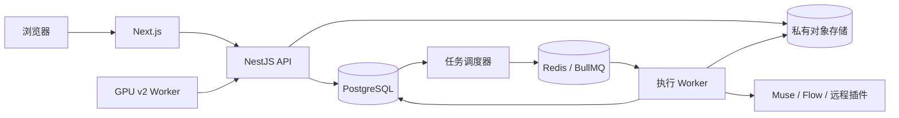

# 运行与验收

## 进程拓扑



API、worker、Web 可分别扩容。数据库保存可恢复任务状态；Redis 队列只负责分发。启用多副本前改用共享 S3，统一所有实例的 `ENCRYPTION_KEY`，并控制数据库连接总量（当前每进程连接池上限 15）。不要让单个插件的并发超过其上游许可。

## 启动顺序

Compose 默认启动原协议 NestJS。先运行 `docker compose build` 和 `docker compose run --rm migrate`，然后初始化管理员或导入旧实例。API 启动检查 PostgreSQL、活跃管理员、配置中的导入标识、私有磁盘路径及 BullMQ Redis；Web 和 worker 在 API 健康后启动。Web 在运行时读 `LEGACY_API_INTERNAL_URL`，镜像无需包含环境配置。详见 [Docker 初始化](../README.md#docker-compose-启动) 和 [导入步骤](MIGRATION.md#导出与导入)。

`WORKER_CONCURRENCY` 控制单个 worker 处理数，默认 8。连接的并发是所有 worker 合计的数据库约束。GPU 连接的并发同样跨节点生效。

## 原协议 Studio 多副本一致性验收

基于 PR 47 `acfc58e`，于 2026-11-18 在 macOS ARM64 上用 Node 24.22.3、Next 16.4.6、PostgreSQL 18.7、Redis 8.10.3、BullMQ 5.81.5 和 SeaweedFS 4.54 完成回环验收。两套生产构建的 Next 各自转发到不同的原协议 Nest 进程。两套各有一个真实 worker，`WORKER_CONCURRENCY=1`，共用同一临时 PostgreSQL、带 ACL 的 Redis 及私有 S3 应用桶。一次实测的 Next PID 为 `40297` 与 `40308`，Nest PID 为 `40293` 与 `40305`，worker PID 为 `40296` 与 `40307`。共享 Redis 报告两个不同的生成队列 consumer。

- 仅在第一套入口登录。两套入口使用同一合成会话并发发送 8 个原协议图片请求，每套各 4 个。4 个相同 UID 返回同一数字任务 ID，4 个不同 UID 各自产生一个任务。完成后重放相同 UID，仍返回原 ID。5 个任务各调用环回插件一次，各关联 1 个数据库产物和 1 个桶内对象。
- 向工作区发放 100 积分，每个任务 5 积分。提供方回执暂挂时，可用 75、冻结 25。结算后余额 75、冻结 0。按任务逐笔核对原协议历史和 PostgreSQL 账本，每个任务各有一次冻结、一次扣费。
- 连接限额为 1 时，暂挂首个提供方响应以保持第一个 BullMQ job 为 `active`。另一 worker 处理过后续队列投递，对应 PostgreSQL 任务仍为 `queued`，提供方实测峰值为 1。随后经管理 API 将同一连接的限额调到 2，首个响应仍暂挂，两个单槽 worker 同时各持有一个 BullMQ 活动任务及提供方请求，实测峰值为 2。
- 两个入口都为同样的 5 个媒体 ID 返回对应私有对象的签名 URL，下载字节与模拟产物一致。另一工作区的合成账号看不到任务、无法切入原工作区，从两套入口读取媒体均返回 404。匿名通过两套入口读取返回 401，直接访问未签名 S3 URL 返回 403。

复跑命令如下。需要 Node 24、pnpm、PostgreSQL 的 `initdb` 和 `postgres`、`redis-server` 以及 SeaweedFS `weed`。可用 `PG_BINDIR`、`REDIS_SERVER`、`STUDIO_WEED` 指定二进制位置。

```sh
pnpm install --frozen-lockfile
pnpm build
pnpm test:studio:replicas
```

启动器分配随机回环端口、临时目录和新凭据，只连接临时服务和本地版本化示例插件。桶探针使用独立的临时桶，验收时核对应用桶的完整对象清单。退出时停止子进程并移除临时数据。实测覆盖双副本下的幂等、账务、工作区权限及一个连接的并发约束。生产规格的持续负载、延迟与吞吐、滚动更新和副本故障，以及真实上游、对象存储及支付仍需预发验证。

## 凭据与媒体

密钥使用 AES-256-GCM 加密写入 PostgreSQL，连接 API 不返回明文。旧任务保留加密配置快照，用于避免管理员换密钥时改变在途任务。加密密钥和数据库应独立备份并一同恢复。生产数据库、Redis、插件服务只允许内部网络访问，站点由 HTTPS 入口提供服务。

磁盘存储支持范围读取，S3 使用短期签名下载地址。上传会实际解析内容。工作区默认 20 GiB 配额，数据库触发器原子计量，避免并发上传超额。修改配额可通过受控数据库迁移操作 `workspaces.storage_limit`；当前没有管理页配额编辑。

备份包含 PostgreSQL、对象存储、加密密钥和部署配置。定期演练还原，禁止仅备份 Redis。上传后数据库提交失败可能产生未引用媒体对象，清理应以数据库引用核对并保留宽限期；当前未附带自动对象垃圾回收器。

## 目标栈停写备份与恢复

1. 关闭写入入口，停止 API、调度器和 worker，并停止 GPU 节点回传。记录 PostgreSQL 中待处理任务的状态、上游任务 ID、回执及租约。计划停机时可先排空任务再停进程。
2. 使用匹配服务器版本的 `pg_dump --format=custom --file=studio.dump --dbname="service=studio-source"`。保持停写，按原对象键导出私有桶的对象内容、MIME 类型及元数据，核对清单、大小和 SHA-256。单独保管 `ENCRYPTION_KEY` 与部署配置，并将它们关联到同一份备份。
3. 启动独立 PostgreSQL 实例、新 Redis 和新私有桶。使用 `pg_restore --single-transaction --exit-on-error --no-owner --no-privileges --dbname="service=studio-target" studio.dump` 写入空数据库，按目标部署角色配置数据库权限。按对象清单还原至新桶并复核字节。上述 `service` 名须在 PostgreSQL 客户端连接配置中分别指向源和目标。
4. 使用目标 PostgreSQL、Redis 和对象存储连接配置，保留备份对应的 `ENCRYPTION_KEY`。将 `STUDIO_MEDIA_ORIGIN` 指向可供浏览器访问的目标 S3 签名地址源。先对账钱包余额、冻结额、最后一笔账本及充值记录，再启动同版本 Next、Nest 和 worker。验收原会话和重新登录、公开编号、私有媒体、画布和对话，复核待处理任务和重复提交后再恢复写入。

合成演练入口为 `pnpm build` 后运行 `pnpm test:studio:restore`。需要 Node 24、pnpm、PostgreSQL 的 `initdb`、`postgres`、`pg_dump`、`pg_restore`，以及 `redis-server`、SeaweedFS `weed`、`openssl`、`ffmpeg` 和 `ffprobe`。可用 `PG_BINDIR`、`REDIS_SERVER`、`STUDIO_WEED` 指定路径。脚本在随机回环端口和临时目录启动两套数据服务，使用模拟商户、模型端点和普通 GPU 节点。对话和请求型任务等待实际租约过期。GPU 过期场景将合成任务的租约截止时间设为已过期，由现有协议执行回收。退出时清理数据。

2026-11-18 使用 PostgreSQL 18.7、Redis 8.10.3 和 SeaweedFS 4.54 完成合成演练。目标使用新的 PostgreSQL cluster、空 Redis、新私有桶和独立连接凭据。启动前对比钱包、账本、充值、身份和应用记录。启动后验证旧会话、重新登录、公开编号递增、对象的 SHA-256 与 HTTP 完整字节及 Range、画布修订冲突、聊天历史和模拟 ZPay 的订单及通知重放。排队且未被领取的对话由新 worker 处理并扣费一次，已请求上游且未完成的对话在租约到期后变为 `interrupted` 并退款一次。

基于 PR47 `743b59e` 扩展的停写演练覆盖以下在途任务。

- Muse 已保存上游任务 ID。恢复后查询同一 ID，成功时保存一次，查询返回 404 时失败退款。Flow 已保存成品回执。恢复后使用原回执和任务的加密配置快照保存，成品已缺失时按恢复保存错误退款。Flow 场景跨插件目录升级暂存，恢复按各任务接受时锁定的版本执行。
- Muse 和 Flow 的请求均已到达模拟端点、提交结果仍未知时，租约到期后以原协议结算失败，记录 `request_uncertain` 并退款一次。通过回环日志核对两个提供方的生成请求次数，确认恢复只发出预期的查询和下载。
- 普通 GPU 节点持有效票据可续租、领取原任务和交付。第一次租约过期后由另一节点领取并获得新票据，第二次租约过期后失败退款。对已换票和已失败的任务验证旧票据无法续租、读回执或提交结果。
- 逐任务对账冻结、扣费或退款及执行记录，核对产物关联和目标私有桶清单。验证成品签名链接、完整字节及 Range，并重放原任务 UID 和成功的 GPU 交付。

在线备份一致性仍需单独验证。

## 故障语义

- 排队任务尚未调用上游，可安全取消并释放积分。
- 支持续查的插件可根据上游任务 ID 继续查询。支持恢复落盘的插件可凭已保存的回执继续保存媒体。
- 提交结果未知且插件没有专用恢复规则时，执行器将任务标记为 `uncertain` 并保留冻结积分。具有原协议请求生命周期的插件可将任务结算为失败并记录 `request_uncertain`。这两种路径都避免自动重发这次未知提交。
- 普通 GPU 使用 180 秒租约。第一次租约被回收后任务可再次领取。原节点在尚未重新分配且其槽位空闲时可按原协议续租。任务换票或耗尽重试机会后，旧票据不能续租或提交结果。
- 队列丢失后从 PostgreSQL 重新分发。数据库租约和任务状态防止重复执行已结算任务。
- 对话的未领取任务由 PostgreSQL outbox 重新投递。已领取的对话在租约过期后标记为 `interrupted` 并退回冻结积分。
- 管理员核对任务须记录理由。远程同步插件若没有查询能力，应先核对提供方后台，再选择结束并释放积分。

## 已验证与待验证

自动测试覆盖 PostgreSQL 事务语义、租户权限、幂等、GPU 回传、插件升级快照、充值防伪和重复结算、Pure 数据迁移、Nest HTTP 入口、Muse/Flow/兼容图片协议以及真实 FFmpeg 合成。CI 使用 PostgreSQL 与 Redis 服务，包含 BullMQ 投递测试和 Docker 构建。

`test:studio:nest` 和 `test:studio:upgrade` 使用隔离的 PostgreSQL、Redis/BullMQ、私有磁盘或 SeaweedFS 及 Chromium 验收默认 React 工作台。覆盖固定路由、支付回跳、停机响应、数据服务重启和合成旧库。[整合验收记录](STUDIO_STACK_ACCEPTANCE.md)

PR45 已在隔离 Linux ARM64 虚拟机从空卷执行 Compose 构建、迁移、管理员初始化和启动。通过 Next 验证了登录、数字工作区、画布写入、匿名媒体拒绝、登录会话下的 Range，以及原协议与 v2 请求的独立分派。回环对话提供方通过真实 worker 返回 SSE，重放同一消息 UID 后冻结已释放，只发生一次扣费。显式 Advanced 模式和切回原工作台也已验收。真实商户、提供方账号、生产对象存储和实际部署负载仍需在受控预发环境验证。

上线验收至少需要：

1. 在部署同版本的独立预发环境，从停写时取得的 SQLite、媒体和头像一致性备份演练导入及完整还原。对账所有钱包、最后一条账本余额、历史充值和贡献奖励，确认任务、私有对象、画布、对话和工作区成员记录完整。
2. 验证外置密钥、实际 PostgreSQL 连接和 Redis 认证、私有对象存储权限，以及 HTTPS 反向代理下的登录、同站 Cookie、写入来源校验、私有媒体 Range、大文件和 SSE。S3 多副本、私有访问及恢复在对象存储专项验收。
3. 在预发配置获授权的提供方连接，验证 Muse、Flow、图片、对话及 GPU 的成功、失败、超时与恢复，核验普通节点重新配对，以及旧贡献客户端的登记、领取与回传均已关闭。用测试商户验证 ZPay 和 EPusdt 异步通知、主动查询、重复通知和对账。
4. 在预期峰值下测 API p95/p99、排队时长、并发连接、数据库占用、媒体内存/带宽和上游 429。中断 worker、Redis、GPU 和对象存储，确认队列恢复并只结算一次。
5. 完成记录过的停写、导入、对账、放流和回退演练。回退前核对目标新增写入，按同一站点 origin 验证重新登录及保留的浏览器草稿。按最终 UI 专项的验收结果决定候选的放流范围。

不能从框架名称推导可承载用户数。提供方额度、GPU 吞吐、排队策略和对象存储通常需要分别测量。
