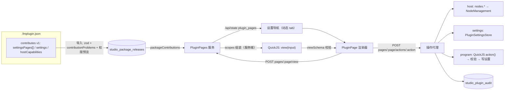

# 插件扩展平台 v1：设计方案

> 状态：已定稿，进入实施。契约源文件：[contributions.ts](../packages/plugin-sdk/src/contributions.ts)、[plugin-settings.ts](../packages/platform/src/plugin-settings.ts)、[035_plugin_extensions.sql](../migrations/035_plugin_extensions.sql)。
> 背景：设置页重排时确认，插件贡献的菜单目前只有 GPU 节点一个特例。未来会接入更多插件，本方案把这一特例改成通用的扩展点。

## 1. 现状与问题

| 位置 | 现状 | 限制 |
| --- | --- | --- |
| 包格式 `studio-packages.ts` | 顶层单个 `settingsPage: {title, render}` | 一个包最多一页；只允许 `mode: pull` 且带节点程序的包使用 |
| 状态 `original-api/src/state.ts` | `gpu_node_settings`，SQL `LIMIT 1` | 全站最多一个插件页；字段名写死为 GPU |
| 节点扩展 `plugins.ts#nodeExtension` | 以 `package ? 'settingsPage'` 判定“节点插件” | 设置页和节点能力耦合，新增页面会被误判为节点插件 |
| 前端 `Settings.tsx` / `settings-tabs.ts` / `SettingsShell.tsx` | 固定 tab `"gpu"`，固定放在「账户」组 | 无法出现第二个插件页，无法选择分组和顺序 |
| 面板 `PluginPanel.tsx` | 视图结构是 GPU 专用（`add` 配对表单 + 节点 `rows`）；`allowedPath` 写死节点接口 | 其他插件无法复用；操作授权依赖前端正则 |
| 面板输入 | 浏览器把 `nodes/gpu_models/jobs` 发给 `/plugins/:id/panel` | 输入由客户端提供；无法给成员开放页面 |
| 插件配置 | 只有连接级 `configSchema`（含密钥） | 插件没有自己的非密钥设置，也没有升级迁移 |

## 2. 目标与非目标

**目标**

1. 一个包可以贡献 0–8 个设置页，每页用「插件 ID + 页面 ID」标识，自选图标、分组、顺序、可见条件和受众（管理员 / 成员）。
2. 页面由宿主渲染：插件只返回 JSON 视图（视图 schema v1），复用 Studio 现有样式和对话框，不注入任何插件 HTML/JS 到浏览器。
3. 最小权限：页面声明读取范围（scopes）和操作（actions）；宿主在服务端组装输入、在服务端执行操作；安装确认页列出全部权限。
4. 插件拥有自己的非密钥设置（全站 / 每个工作区），schema 校验、带修订号的乐观并发、升级迁移、回滚恢复、移除清理。
5. 所有页面操作写审计记录（操作者、工作区、目标、结果）。
6. 完全向后兼容：已安装的 GPU 1.x 包（数据库中旧 release 字节不变）继续按原样工作，界面无回归。

**非目标（本轮不做，见 §9 路线图）**：无模型的纯扩展包、插件设置进入任务快照影响生成、成员页操作、事件订阅 / Webhook、第三方支付插件、插件自绘 UI。

## 3. 总体架构



## 4. 包格式：`contributes` v1

包顶层新增可选字段 `contributes`，与旧 `settingsPage` 互斥（同时出现即 400）。完整 zod 定义见 `contributesSchema`。

```json
{
  "contributes": {
    "version": 1,
    "hostCapabilities": [],
    "settings": {
      "global": {"type":"object","additionalProperties":false,"properties":{"style":{"type":"string","enum":["写实","动画"],"default":"写实"}}},
      "workspace": {"type":"object","properties":{"watermark":{"type":"boolean","default":false}}},
      "migrate": "(values, { scope, from, to }) => values"
    },
    "settingsPages": [
      {
        "id": "defaults", "title": "默认风格", "icon": "sliders", "group": "services", "order": 100,
        "audience": "admin", "visibleWhen": "installed",
        "scopes": ["plugin", "settings"],
        "actions": [{"id":"save","kind":"settings","scope":"global"}],
        "program": "({ view(input) { return { schema: 1, title: '默认风格', blocks: [] } } })"
      }
    ]
  }
}
```

**结构规则**（`contributionProblems`，导入和升级都执行）：页面 / 操作 ID 唯一；`nodes` 范围与 `host` 操作要求对应宿主能力；`nodes` 能力要求 `mode: pull` + 节点程序（安装时另查适配器导出 `NodeManagement`）；读取 `settings` 或使用设置操作必须声明对应 schema；设置 schema 必须是对象且不得含 `writeOnly`（密钥只放连接配置）；成员页只能读取 `plugin/models/jobs/settings` 且暂不允许操作。

**旧格式归一化**（`packageContributions`）：旧 `settingsPage` 归一为页面 `nodes`（`legacy: true`，图标 gpu，「账户」组，顺序 0，scopes `plugin/nodes/jobs`，六个 `nodes.*` 宿主操作）和能力 `["nodes"]`。数据库中的旧 release 不改写。

`nodeExtension` 改为按“归一化后含 `nodes` 能力”判定节点插件，不再看 `settingsPage` 是否存在。

## 5. 运行时

### 5.1 页面列表

`/api/state` 新增 `plugin_pages: PluginPageEntry[]`：遍历 `installed` 的包（`removing` 中的包保留到移除完成），按 `visibleWhen`（`enabled` 时还要求包已启用）和受众过滤，按 group → order → title 排序。tab key 为 `plugin:<pluginId>:<pageId>`。`gpu_node_settings` 保留一个版本周期，供旧前端和现有测试使用。

### 5.2 视图

`POST /api/plugins/:plugin/pages/:page/view`（请求体 `{}`，工作区由 `X-Workspace-Id` 决定）

1. 校验页面存在、可见、受众（admin 页要求管理员；member 页要求可访问当前工作区）。
2. 服务端按 `scopes` 组装输入（§4 注释中的字段表）。输入不含提示词、媒体、用户身份和任何连接配置。
3. 新页面：`loadProgram(program)` 后调用 `view(input)`；旧页面：沿用 `({view: render})` 并组装旧输入 `{enabled,pending,nodes,models,jobs}`。
4. 新页面的输出用 `viewSchema` 严格校验，失败返回 422「插件设置页输出无效」；旧页面输出交给旧 `PluginPanel`（保持原逻辑）。

QuickJS 沿用现有限制（16 MB 内存、100 ms、2 MB 输出），无网络、文件、计时器和宿主对象。

### 5.3 视图 schema v1

块类型：`notice`、`text`、`stats`、`keyValue`、`list`（行含状态、元数据、详情和按钮）、`form`（`inline` 或 `dialog`；字段 text/textarea/number/select/multiselect/checkbox）。按钮引用本页声明的操作 ID，可带 `target`、`payload`（≤4 KB）、`confirm`，或用 `opensForm` 打开对话框表单。视图只描述数据和意图，样式、焦点管理、确认框和无障碍由宿主统一实现。

### 5.4 操作代理

`POST /api/plugins/:plugin/pages/:page/actions/:action`，请求体 `actionRequestSchema`，返回 `ActionResult`。

| kind | 执行 | 权限与校验 |
| --- | --- | --- |
| `host` | 宿主操作表：`nodes.suggestName / pair / drain / stop / resume / remove` 映射到该包 `NodeManagement` 的 `suggestedName / pair / manage` | 管理员；能力已声明；`target` 为正整数节点 ID；`pair` 返回 `{name, command}`，转为可复制的 `result` |
| `settings` | `payload` 作为完整值写入对应范围 | 管理员；schema 校验；`revision` 乐观并发，冲突 409 |
| `program` | QuickJS `action(id, payload, input)`，输出按 `programActionOutputSchema` 校验，再经 `PluginSettingsStore.write` 落库 | 管理员；与视图相同的输入组装；写入同样受 schema 和修订号约束 |

每次调用（成功、拒绝、失败）写一行 `studio_plugin_audit`。错误信息沿用 `DomainError` 的中文提示，不回传 QuickJS 堆栈。

## 6. 插件设置生命周期

| 事件 | 行为（`PluginSettingsStore`） |
| --- | --- |
| 首次读取 | 无行时返回 schema 默认值，`revision: 0` |
| 保存 | 校验 → 比对修订号 → 写入（≤64 KB） |
| 升级 | 同一事务内 `migrate(from,to)`：有 `settings.migrate` 先运行，再按新 schema 校验；失败则整个升级回滚并提示原因。旧值存入 `previous_values` |
| 回滚 | `restore(version)` 恢复升级前的值；没有保存值时按 `migrate` 处理 |
| 移除 | 移除完成（在途任务结算后）时 `purge`；之后重新安装从默认值开始 |
| 停用 | 不影响设置 |

安装 / 升级确认页新增「权限」段：每页标题、受众、读取范围（中文名）、可执行操作，以及设置范围；升级时标出新增或扩大的权限。

## 7. 前端

- `settings-tabs.ts`：`SettingsTab` 扩展为固定 tab 或 `plugin:${string}:${string}`；旧链接 `gpu` 映射到首个 legacy 节点页。
- `SettingsShell.tsx`：分组由固定 tab 和 `plugin_pages[].group` 合并生成，搜索覆盖插件页标题。
- `Settings.tsx`：插件页 section 由 `plugin_pages` 生成；`legacy` 页渲染现有 `PluginPanel`；新页渲染 `PluginPage`。`plugin_pages` 缺失时退回 `gpu_node_settings` 行为。
- `PluginPage.tsx`：按 §5.3 渲染块；按钮走 `confirm` → 操作接口；表单提交带 `revision`；`result` 用现有对话框展示可复制值；操作后按 `refresh` 重新取视图并刷新状态；加载、错误、空状态与现有设置页一致；320–1440px 无横向溢出。

## 8. 实施分工与验收

基线分支 `feat/plugin-extensibility`（自 `origin/main`，已含本文档和契约文件）。各工作流在独立 worktree 中从基线开始，只改自己负责的文件；契约文件需要调整时先报告，不得自行修改。

| 工作流 | 负责文件 | 交付与验收 |
| --- | --- | --- |
| W1 平台：包格式与生命周期 | `packages/platform/src/studio-packages.ts`、`studio-updates.ts`、`plugins.ts`（`nodeExtension`）、回滚相关 API 调用点；新测试 `tests/advanced/plugin-contributions.test.ts` | `packageFile` 接受 `contributes`、互斥旧字段；导入执行 `contributionProblems` 和 `NodeManagement` 检查；去掉“设置页必须是节点插件”的限制；预览列出权限与变化；升级 / 回滚 / 移除完成时调用设置存储；GPU 旧包安装、节点页、配对、移除行为不变 |
| W2 运行时与 API | 新 `packages/platform/src/plugin-pages.ts`、新 `apps/api/src/original-plugin-pages.ts`（并在 `original.ts` 注册）、`packages/original-api/src/state.ts`；新测试 `tests/advanced/plugin-pages.test.ts` | §5 全部行为；权限矩阵（管理员 / 成员 / 跨工作区）；viewSchema 拒绝无效输出；三类操作、修订冲突、审计记录；`plugin_pages` 排序和可见性；旧 GPU 页仍可用 |
| W3 前端 | 新 `apps/web/studio/PluginPage.tsx`（及配套 CSS）、`Settings.tsx`、`SettingsShell.tsx`、`settings-tabs.ts`、`apps/web/studio/state.ts` | §7 全部行为；`pnpm typecheck:web` 通过；不改动非插件设置页的行为和文案 |
| W4 示例、打包与文档 | 新 `plugins/example-extension/`、`scripts/build-studio-packages.mjs`（仅新增通用 `contributes` 打包）、`docs/PLUGINS.md`；新测试 `tests/advanced/example-extension.test.ts` | 一个 remote 模式示例包，两页（设置表单 + 概览列表含 program 操作），声明全局和工作区设置及 `migrate`；测试用契约校验包并以样例输入运行每页 `view` 通过 `viewSchema`；文档写清字段、权限、生命周期和调试方法 |

**集成验收（负责人 Agent）**：合并四个分支 → `tsc --noEmit`、`pnpm typecheck:web`、`pnpm test`、`pnpm build` → 在快反环境中导入 GPU 旧包与示例包，验证导航并存、设置保存 / 冲突、操作审计、停用 / 移除 / 重装、升级迁移与回滚，以及 320 / 390 / 728 / 1440px 布局。

## 9. 路线图

1. **设置进入执行快照**：`Execution.pluginSettings`（及 QuickJS `request()` 的 `settings` 参数），在受理任务时随插件版本、价格一起冻结，保证重试结算一致。
2. **纯扩展包**：无模型、无连接的包（如字幕导出、素材校对），需要放宽 `manifestSchema.models.min(1)` 并把目录 / 连接逻辑与包解耦。
3. **成员页操作**与用户级设置。
4. **事件订阅**：任务完成 / 失败、插件状态变化的只读事件，经 QuickJS 或远程端点处理，带重放保护。
5. **更多宿主能力**：如 `storage.export`（受控导出到私有存储）、`chat.tools`。每项能力单独评审并在确认页展示。
